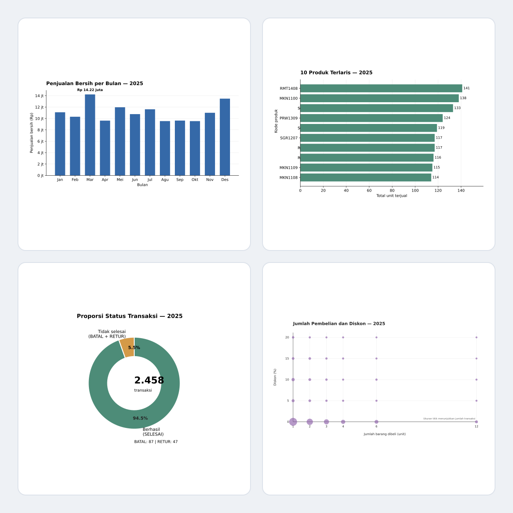

# Analisis Transaksi POS 2024–2025

## Tugas 1 — Analisis Pendapatan

[Notebook Analisis Pendapatan](notebooks/analisis_transaksi_pos.ipynb)

- Pemeriksaan duplikat, nilai kosong, dan kuantitas tidak wajar.
- Pembersihan format tanggal dan harga.
- Perhitungan pendapatan kotor, diskon, dan pendapatan bersih untuk 2024–2025.

## Tugas 2 — Manipulasi Data dengan Pandas

[Notebook Manipulasi Data](notebooks/tugas_manipulasi_data_pandas.ipynb)

- Pembersihan dan perubahan tipe data.
- Penanganan nilai kosong dan kuantitas negatif.
- Operasi aritmatika, penyaringan, dan pengurutan.
- Pengelompokan data menggunakan `.groupby()`, `.agg()`, dan `.transform()`.

## Tugas 3 — Visualisasi dengan Matplotlib

[Notebook Visualisasi Transaksi](notebooks/visualisasi_transaksi_pos.ipynb)

Empat visualisasi transaksi tahun 2025 digabung menjadi satu gambar rasio 1:1. Grafik tidak dipotong dan dipisahkan dengan jarak antarpanel.

