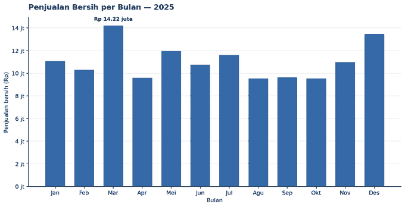
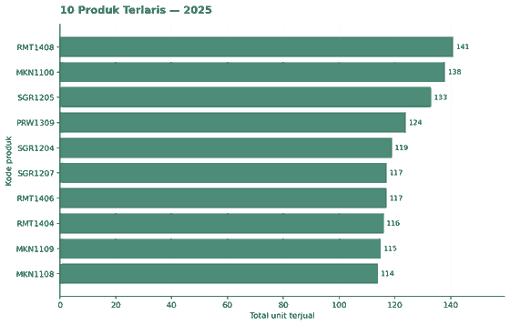
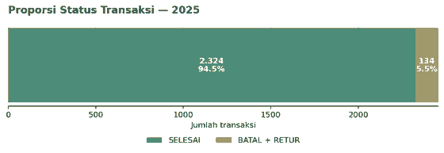
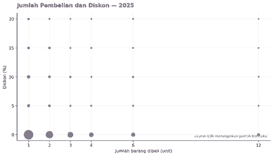

# Analisis Transaksi POS 2024–2025

Repository ini berisi notebook pengolahan dan visualisasi data transaksi POS dengan dataset yang sama.

Dataset: `paket_a_transaksi_pos_2024_2025.csv`.

## Daftar Tugas

### Tugas 1 — Analisis Pendapatan

File: `analisis_transaksi_pos.ipynb`

- Memeriksa duplikat dan nilai kosong.
- Membersihkan format tanggal dan harga.
- Memeriksa kuantitas yang tidak wajar.
- Menghitung pendapatan bersih tahun 2024 dan 2025.
- Menyimpan ringkasan pendapatan dan grafik.

### Tugas 2 — Manipulasi Data dengan Pandas

File: `tugas_manipulasi_data_pandas.ipynb`

- Membersihkan format harga dan mengubah tipe data menjadi numerik.
- Mengubah kuantitas negatif menjadi positif.
- Mengisi kode kasir kosong dan memilih kolom dengan `.iloc[]`.
- Menghitung omzet kotor, diskon, omzet bersih, dan PPN 11%.
- Menyaring dan mengurutkan transaksi.
- Membuat laporan gerai dengan `.groupby()`, `.agg()`, dan `.transform()`.

### Tugas 3 — Visualisasi dengan Matplotlib

File: `visualisasi_transaksi_pos.ipynb`

Empat grafik dibuat dari dataset yang sama:

1. Penjualan bersih per bulan tahun 2025.
2. Sepuluh produk terlaris berdasarkan total unit terjual.
3. Proporsi transaksi berhasil dan tidak selesai.
4. Hubungan jumlah pembelian dengan persentase diskon.

## Hasil Visualisasi Tahun 2025

Data dibersihkan dengan menghapus 30 baris duplikat. Grafik penjualan dan produk terlaris hanya memakai transaksi `SELESAI` dengan jumlah 1–12 unit. Penjualan bersih dihitung setelah diskon dan sebelum PPN. Batas jumlah 1–12 mengikuti pemeriksaan kuantitas pada tugas analisis sebelumnya agar nilai salah input tidak mendominasi grafik.

Status transaksi dihitung dari seluruh 2.458 transaksi tahun 2025: 2.324 `SELESAI`, 87 `BATAL`, dan 47 `RETUR`. Grafik proporsi membandingkan `SELESAI` dengan gabungan `BATAL` dan `RETUR`; retur tetap dicantumkan terpisah agar status aslinya jelas.

### 1. Penjualan Bersih per Bulan

### 2. Sepuluh Produk Terlaris

### 3. Proporsi Status Transaksi

### 4. Hubungan Jumlah Pembelian dan Diskon

## Hasil Analisis Pendapatan

| Tahun | Jumlah Transaksi | Total Barang | Pendapatan Kotor | Total Diskon | Pendapatan Bersih |
| :---: | :---: | :---: | :---: | :---: | :---: |
| **2024** | 2.327 | 5.967 unit | Rp 130.883.500 | Rp 3.477.025 | **Rp 127.406.475** |
| **2025** | 2.345 | 6.050 unit | Rp 138.664.000 | Rp 3.662.900 | **Rp 135.001.100** |

## Menjalankan Notebook

Buka notebook melalui Jupyter Notebook atau Google Colab. Letakkan file CSV di direktori yang sama dengan notebook. Paket yang digunakan: `pandas` dan `matplotlib`.
